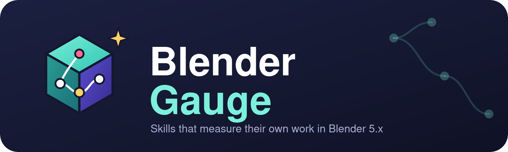
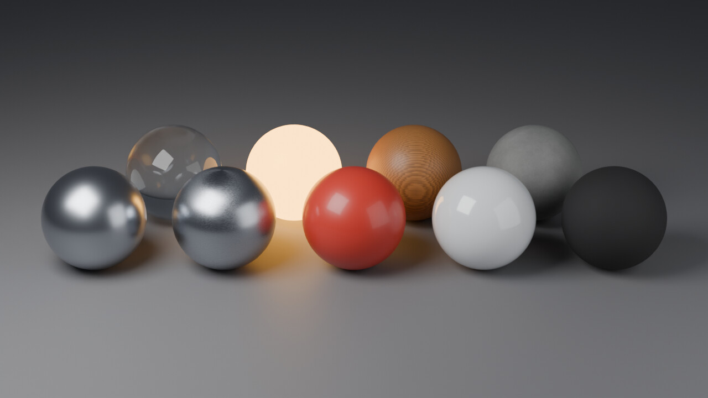
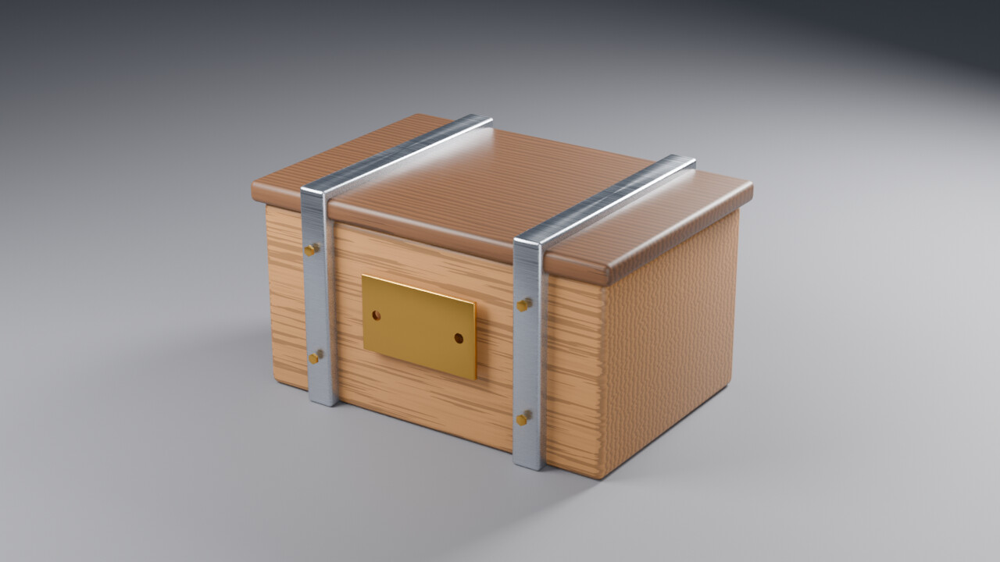
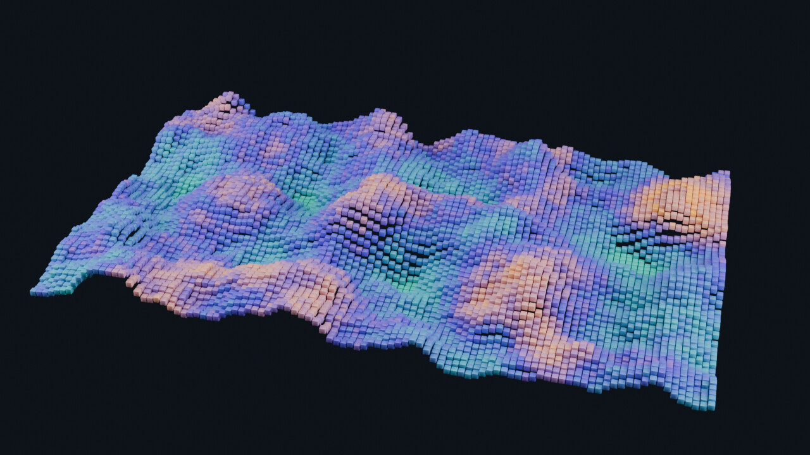
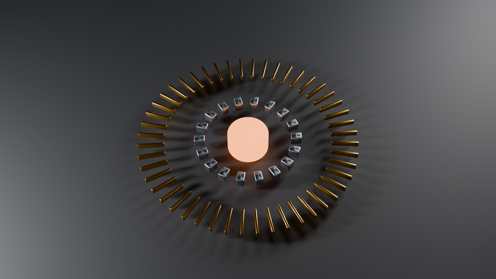
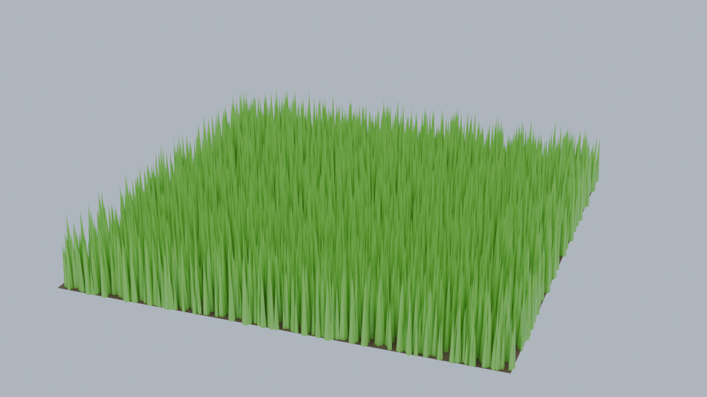
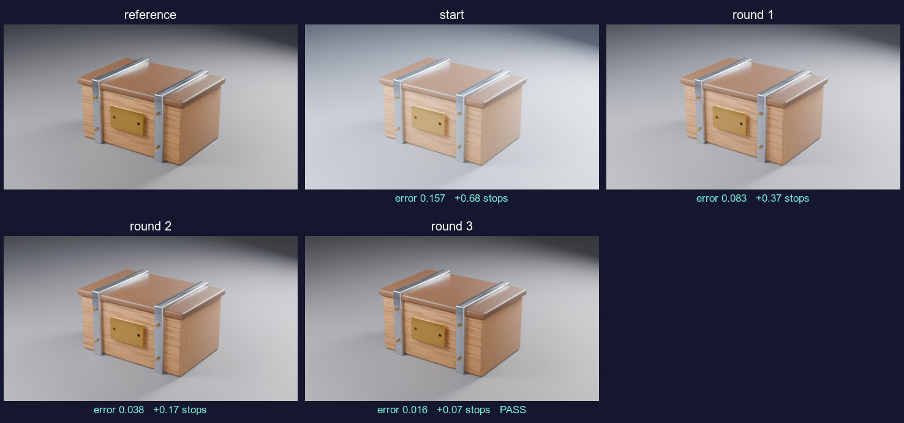
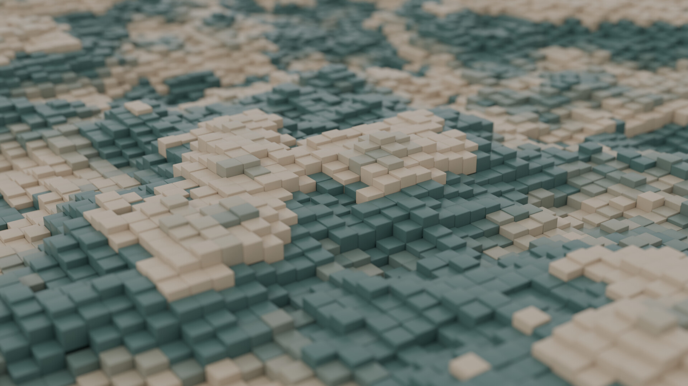

<p align="center"></p>

<h1 align="center">Blender Gauge</h1>

<p align="center"><b>Skills for AI agents working in Blender 5.x that measure their own work.</b><br>
Build, then gate: every skill ends in a script that returns numbers, limits and a fix hint.</p>

## The idea

Blender work fails quietly: a bevel that never applied, a roughness texture in the wrong colour space, a subject cropped by the camera, a light visible in shot. An agent that "looks at the picture" misses these. Gauge turns each of them into a **check with a value, a limit and a hint**, and every gate script prints one machine-readable line:

```json
GAUGE_JSON {"gate":"mesh-health","pass":false,"failed":["ngons"],
  "checks":[{"name":"ngons","value":12,"ok":false,"limit":"<= 0","hint":"triangulate or re-quad the n-gons"}], "info":{...}}
```

The agent fixes what failed, runs the gate again, and stops when it passes. The same scripts run in a live Blender (through [blender-mcp](https://github.com/dnlgalleguillos/blender-mcp-claude-code) `run_blender_script`) and headless (`blender -b`).

## Gallery

Every image below was produced by the skills' own scripts (`gallery/`), and every one passed its gates. Results are in [`assets/gallery/gates.json`](assets/gallery/gates.json). Rendered with Cycles on a 4-core CPU, 1280x720, 96 samples, AgX.

| | |
|---|---|
| <br>**Nine material presets** (`gauge-materials`): metal, brushed metal, plastic, ceramic, rubber, glass, emissive, wood, concrete. A gate checks that no two swatches render the same and that none is hidden behind another. | <br>**Hard-surface crate** (`gauge-modeling`): 9 parts, 1380 triangles, real bevels, holes cut through the plate. Camera framed to fill 70 % of the frame, three-point rig with key:fill 4.0. |
| <br>**Noise landscape** (`gauge-geonodes`): 6000 instanced cubes, colour read from a stored `height` attribute. Largest step between neighbours 0.12 m, checked by the gate. | <br>**Radial arrays** (`gauge-geonodes`): 48 + 18 instances placed on circles of exact radius (measured, not eyeballed), dramatic rig. |
| <br>**Surface scatter** (`gauge-geonodes`): 8089 blades with random size and spin, overcast light, depth of field. | <br>**Reference matching** (`gauge-reference`): lighting made 3x too bright and blue on purpose; each round applies the correction the gate asked for. Error 0.157 -> 0.083 -> 0.038 -> 0.016, pass on round 4. |

## Example

[`examples/wavy-cubes`](examples/wavy-cubes/README.md) builds a full scene end to end: a bevelled cube instanced 12 996 times over a noise-lifted grid, two-colour material read from a stored attribute, grazing camera with depth of field, 1920x1080 Cycles render. It shows the measured decisions along the way (noise roughness vs neighbour steps, a check that no grid edge is visible).

[](examples/wavy-cubes/README.md)

## Skills

| Skill | What it does | Its gate checks |
|---|---|---|
| [`gauge-core`](skills/gauge-core/SKILL.md) | Start here: the measure-then-fix loop, how to run scripts, Blender 5.x facts verified by running them | scene snapshot |
| [`gauge-scene`](skills/gauge-scene/SKILL.md) | Units, applied scale, names, collections; safe tidy with dry run | hygiene |
| [`gauge-modeling`](skills/gauge-modeling/SKILL.md) | Bevelled parts kit built with `bmesh`, hole cutting, prop builder, mesh repair | n-gons, holes, inverted normals, duplicate / loose geometry, UV density |
| [`gauge-materials`](skills/gauge-materials/SKILL.md) | Material presets as node specs, spec builder, swatch sheet | colour spaces, albedo range, metallic and roughness sanity, links |
| [`gauge-geonodes`](skills/gauge-geonodes/SKILL.md) | JSON recipes (height grid, radial array, surface scatter), input helper for 5.x | instance count, size, neighbour steps, empty output |
| [`gauge-light-render`](skills/gauge-light-render/SKILL.md) | Camera framing solved by bisection, rigs sized to the subject, presets, turntable | exposure, clipping, contrast, cropping, lights in shot |
| [`gauge-reference`](skills/gauge-reference/SKILL.md) | Copy a look from an image or node screenshots, with measured corrections | exposure in stops, contrast ratio, tint, error |
| [`gauge-export`](skills/gauge-export/SKILL.md) | glTF / FBX / OBJ / STL / USD / PLY, verified by importing the file back | triangles, size, materials, budgets |

## Quick start

Requires Blender 5.x (developed and tested on **5.3.0 Alpha, Linux**). Everything else (`bpy`, `bmesh`, `numpy`) ships with Blender.

**Install the skills**

```bash
python tools/install.py            # copies skills/ into ~/.claude/skills
python tools/install.py --link     # or symlink them while you edit
```

or, in Claude Code: `/plugin marketplace add dnlgalleguillos/blender-gauge`.

**Run a gate headless**

```bash
python skills/gauge-core/scripts/run_headless.py skills/gauge-modeling/scripts/mesh_gate.py --blend asset.blend max_ngons=0
```

```
FAIL mesh-health
  x ngons = 1  (limit <= 0)  -> triangulate or re-quad the n-gons
```

**Run it in a live Blender** with blender-mcp: `run_blender_script` with `path` = the script and `args` = `{"max_ngons": 0}`.

## Develop

```bash
python tools/check_repo.py      # static checks, no Blender
python tools/run_tests.py       # + 68 tests, one headless Blender launch per suite
python gallery/build_gallery.py # re-render the gallery (add --quick for a fast pass)
```

The tests exercise the failing cases too: a gate that cannot fail is not a gate. See [`AGENTS.md`](AGENTS.md) for the rules for changing the code.

## Status and limits

- Version 0.1.0. Verified only on Blender 5.3.0 Alpha (Linux). Other 5.x builds should work but are untested.
- Eight skills. Not covered yet: rigging, animation, UV unwrapping and baking, simulation, sculpting.
- Gallery renders use CPU Cycles; render times (2-3 minutes each) depend on your machine.
- `gauge-reference` measures the displayed image (after the view transform), so a large exposure mistake takes two or three rounds to converge.

## Credits and licence

Made by Daniel Galleguillos Cruz together with Claude (Anthropic). All code, text, images and renders in this repository were written or generated for it. Released under the [MIT licence](LICENSE).
