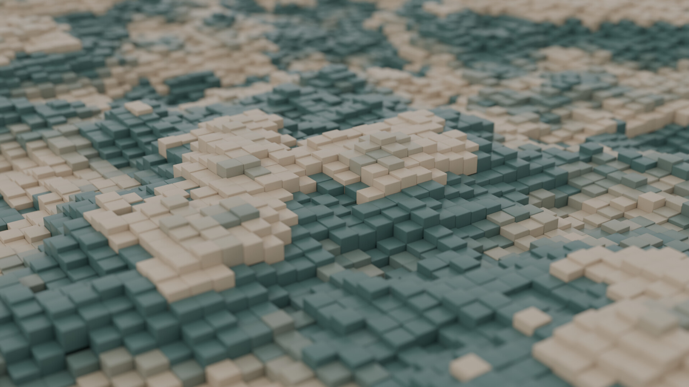

# Example: wavy cubes

A dense grid of small bevelled cubes lifted by smooth noise into stepped hills, in two matte colours that follow the contour lines, seen at a grazing angle with a strong depth of field.



Built end to end with the Gauge skills by [`build_wavy.py`](build_wavy.py): 12 996 instances, 1920x1080, Cycles CPU, 100 samples with adaptive threshold 0.01, denoise on, AgX (Base Contrast), about 7 minutes on 4 cores.

```bash
python skills/gauge-core/scripts/run_headless.py examples/wavy-cubes/build_wavy.py          # full render -> examples/wavy-cubes/_out/
python skills/gauge-core/scripts/run_headless.py examples/wavy-cubes/build_wavy.py width=960 height=540 samples=24   # 40 s preview
python skills/gauge-core/scripts/run_headless.py examples/wavy-cubes/build_wavy.py scan=true render=false           # measure only
```

## What it does

| Stage | Skill / helper | What is measured |
|---|---|---|
| Source cube 2 m, Bevel 0.08 x 3 segments, hidden | `gauge-modeling` `kit.rounded_box` | size, closed mesh |
| Geometry Nodes: Grid, 4D noise, Map Range, Set Position, Instance on Points, Set Material, Set Shade Smooth | `gauge-geonodes` recipe `height_grid`, patched in the script, `gn_make` / `gn_set` | instance count, largest height step between neighbours |
| Material: ramp (Ease) between beige `#CBBCA8` and teal `#5E7F7A`, RGB Curves, Principled; colour read from the stored `noise` attribute | `gauge.node_build` | valid links, output connected |
| Camera: 50 mm, 24 degrees above the surface, f/1.4 focused on a hill | hand placed | cubes across the frame at focus (30-48), **no grid edge visible** (frame corners and edge midpoints are cast onto the surface) |
| World + soft sun, Cycles settings | `gauge-light-render` ideas | exposure, clipping, contrast |

## Decisions, all parameters

- **Noise.** With Roughness 1.0 and Detail 15 the neighbour step reaches 0.14 m (3.5 cubes): static, not hills. Roughness 0.5, Detail 3 and the full Map Range span (0.2-1.8 to -0.3-1.0) give a 0.053 m maximum step (1.3 cubes) with tall relief.
- **Grid.** 4.7 m with 114 x 114 points and cubes that touch (scale 0.0208 on a 2 m cube); a smaller grid shows its edge at a grazing angle, and the script checks that.
- **Colour.** Banding of the stored noise (`bands=7`) makes colour follow the contour lines instead of salt-and-pepper per cube.
- **Underlay.** A dark plane under the cubes stops the bright world showing through slits between deep columns.
- **Matte.** Metallic 0, roughness 0.35.

Measured result: luma 0.46, contrast 0.39, no clipped whites or crushed blacks.
